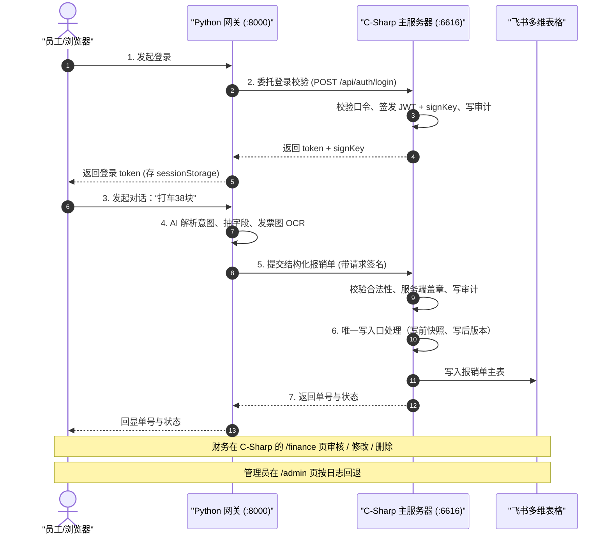

# 报销系统 · AI 对话填单 + 后端核实

> **一句话**：员工对着聊天框说"昨天打车 38 块要报"，AI 把话翻译成一张结构化报销单；
> 但**能不能落表、落成什么样、谁批的、能不能退**，全部由后端按代码里的规则决定，AI 说了不算。

系统由两个独立服务组成，职责严格切开：

| 侧 | 目录 | 技术栈 | 作者 |
| --- | --- | --- | --- | --- |
| **表现层** | `xiaocainu/` | Python 3 + FastAPI | **小新** |
| **校验层** | `AiApprovalServer/` | C# .NET 8 | **星涵** |

**边界一句话：AI 层可以随便理解，落地必须过校验层；校验层拒绝的，AI 层不许绕过**

---

## 目录

1. [这是什么](#1-这是什么)
2. [作者与分工](#2-作者与分工)
3. [全景链路：一次报销怎么走完](#3-全景链路一次报销怎么走完)
4. [C# 侧 · 主服务器](#4-c-侧--主服务器)
5. [Python 侧 · 对话式前端网关](#5-python-侧--对话式前端网关)
6. [账号与播种](#6-账号与播种)
7. [飞书多维表格准备](#7-飞书多维表格准备)
8. [运行与部署](#8-运行与部署)
9. [配置项](#9-配置项)
10. [测试](#10-测试)
11. [已知边界](#11-已知边界)
12. [许可证](#12-许可证)

---

## 1. 这是什么

一个**报销系统的服务端 + 对话式前端**，同时也是一个**AI Agent 的安全执行网关**。

它真正解决的问题是：**让 AI 干活，但保证 AI 干错事也造成不了不可逆后果。**

| 常见风险 | 本项目的做法 |
| --- | --- |
| 员工想看别人的报销单 | 四角色权限矩阵 + 数据边界（员工按登录身份工号过滤，详情再做一次归属校验），服务端强制 |
| 前端或 AI 绕过规则写脏数据 | **报销单只有一个写入口**：枚举白名单、金额区间、状态流转、只读字段全在服务端校验与盖章 |
| AI 被"提示词注入"说服去干坏事 | 规则引擎硬拦截在前，AI 安全审核只做加法，人工审批兜底 |
| 高危操作点错一次回不去 | 每次写飞书前存整行快照 + 撤销日志，管理员可按日志一键回退 |
| 事后说不清谁干了什么 | 审计 JSONL 哈希链（`Seq + PrevHash → SHA-256`），支持整链校验与篡改定位 |
| 账号被拖库后离线爆破 | 每账号随机盐 + 服务端 pepper + 120 万次 PBKDF2 |
| 后台被扫、被爆破 | WAF（含请求体）+ 蜜罐诱捕 + 自动封禁 + IP 白名单 |

**它处理的具体业务**：报销单提交 / 审核 / 修改 / 删除 / 按日志回退；AI 预审打分与批量审核；账号、角色与权限；审计与链路校验；文件与数据类的高危操作审批。

---

## 2. 作者

**星涵**：https://github.com/xingyungames  
**小新**：https://github.com/2154510576-bxd  

---

## 3. 全景链路：一次报销怎么走完



| 步 | 谁做 | 发生什么 |
| --- | --- | --- |
| ① | Python | 用户在网关上登录。网关**自己不发令牌**，把用户名口令转发给 C# |
| ② | C# | `POST /api/auth/login` 校验口令、签发 JWT + 请求签名密钥 `signKey`，并写审计 |
| ③ | Python | 令牌存在**浏览器**（sessionStorage），网关本身无状态、不落库 |
| ④ | Python | AI 解析意图 → 抽出字段 → 发票图走 OCR → 组装成结构化请求 |
| ⑤ | **C#** | 校验枚举、金额区间、城市分级、票据状态、事由长度、开票日期；**服务端盖章**申请人/工号/提交时间/合规结果/状态 |
| ⑥ | **C#** | 写飞书主表（唯一写入口），写前存快照、写后记版本，全程写审计哈希链 |
| ⑦ | C# → Python | 返回单号与状态，Python 回显给用户 |
| — | C# | 财务在 `/finance` 页审核/修改/删除；管理员在 `/admin` 页按日志回退 |

**请求签名**（写操作强制）：

```
X-Timestamp: 毫秒时间戳
X-Nonce:     16~128 字符随机串（去重防重放）
X-Signature: Base64(HMAC-SHA256(signKey, "METHOD\nPATH?QUERY\nTS\nNONCE\nSHA256_HEX(body)"))
```

---

## 4. C# 侧 · 主服务器

**作者：星涵** · `AiApprovalServer/`

### 4.1 技术选型

- **ASP.NET Core 8 最小 API**，单进程、开箱即跑
- **零第三方 NuGet 依赖**：JWT（自实现 HS256 紧凑序列化）、PBKDF2-HMAC-SHA256、AES-256-GCM、`System.Text.Json` 全部来自 BCL —— 依赖越少，可审计面越小
- **JSON 文件即数据库**：原子写（临时文件 + 替换）+ `.bak` 备份 + 独占文件锁 比赛并非数据库安全和算法大赛，json数据库相比之下更好维护
- **前端零依赖**：原生 JS + `textContent`，不用 `innerHTML`/`eval`，严格 CSP
- 发票数据存**飞书多维表格**（本系统不持有独立的业务数据库）

### 4.2 目录结构

```
AiApprovalServer/
├── Program.cs              启动、路由、安全管线装配
├── appsettings.json        全部可调参数（明文，直接改）
├── config/                 凭证模板（secrets.local.json 被 gitignore）
├── Core/                   配置与密钥、数据模型、账号权限策略、报销单策略、JSON 原子存储
├── Security/               JWT、请求签名、防重放、WAF、蜜罐、限流与封禁、审计哈希链、审批签名
├── Tools/                 工具目录、路径守卫、规则引擎、内容风险扫描、Harness、版本库
├── Ai/                     异步 AI 客户端、提示词、注入检测、本地解析降级、多步编排、报销预审
├── Services/               账号、飞书客户端与镜像、报销单写入口、任务状态机、出站通知、维护任务
├── Api/                    认证 / 对话 / 报销单 / 管理后台 四组接口
└── wwwroot/                三个纯静态页面：业务台 / 、财务台 /finance、管理后台 /admin
```

### 4.3 它管住了什么

1. **账号权威**：`App_Data/users.json` 唯一权威；令牌带**世代号 `epo`**，改密/改角色即让旧令牌全部失效。
2. **四角色权限矩阵**：超级管理员 / 管理员 / 财务部 / 员工，细到权限键；"授予管理员"仅超管可做，任何人不能改自己角色，系统必须保留至少一个超管。
3. **报销单唯一写入口**：`/api/invoice/submit` 由本服务代理写飞书，字段类型、枚举、区间、状态流转全部服务端校验并盖章。
4. **审批与可回退**：写前整行快照、写后 Diff + 版本记录，管理员可按日志一键回退（含"删除→重建"）。
5. **可审计**：所有关键节点进 JSONL 哈希链，管理后台可一键校验整链并定位首个断链。

### 4.4 AI 在本侧怎么用

| 用途 | 接口 | 说明 |
| --- | --- | --- |
| 意图解析（多步代理） | `POST /api/agent/chat` | 把自然语言翻译成受约束的工具调用；只读工具可连续多步，**写操作一出现立即停下转人工审批** |
| 操作安全审核 | 内部调用 | 只看 `{intent, 规范化动作}`，**收不到用户原始输入**；判定只能"维持或升级"审批等级，没有任何降级通道 |
| 报销单预审（被动） | `GET /api/invoice/ai-scores` | 每单打 **1–4 级**并给理由：1 绿 / 2 黄 / 3 橙 / 4 红。等级 = `max(规则等级, AI 等级)`，**只升不降**；结果按内容指纹缓存，已审核过的不重复花钱 |
| 按需求选单（主动） | `POST /api/invoice/ai-find` | 财务说"帮我找出所有没问题的单子"，AI **只列候选清单**，服务端二次校验（编造的 recordId 丢弃、状态不对的丢弃） |
| 批量执行 | `POST /api/invoice/batch-review` | **唯一写入口**，必须财务本人点按钮；逐单走正式审核（快照 + 版本 + 审计），可单独回退 |
| 管理台建议 | `GET /api/admin/invoice-ai/*` | 只读，**管理台不存在任何"AI 触发审批/执行"的接口** |

### 4.5 接口总表

**认证**

| 方法 | 路径 | 说明 |
| --- | --- | --- |
| GET | `/api/public/health` | 存活探针，**只回 `status` + `serverTime`** |
| POST | `/api/auth/login` | 登录换令牌 + `signKey` |
| GET | `/api/auth/me` | 当前身份、权限键、AI 状态 |
| POST | `/api/auth/logout` | 退出（写审计） |
| POST | `/api/auth/password` | 改自己的口令（令牌世代 +1，旧令牌全失效） |
| POST | `/api/auth/register` | 创建账号（需登录 + `account.create` 权限，管理员行为） |

**报销单**

| 方法 | 路径 | 说明 |
| --- | --- | --- |
| POST | `/api/invoice/submit` | **提交（唯一写入口）** |
| GET | `/api/invoice/list` | 列表（按角色裁剪范围） |
| GET | `/api/invoice/detail` | 详情（再做一次归属校验） |
| POST | `/api/invoice/review` | 审核（财务及以上） |
| POST | `/api/invoice/update` | 修改（财务及以上，仅可改枚举内字段） |
| POST | `/api/invoice/delete` | 删除（仅管理员，必须填理由） |
| POST | `/api/invoice/rollback` | 按日志回退（仅管理员） |
| GET | `/api/invoice/meta` | 枚举字典与判定口径 |

**AI 预审 / 批量**

| 方法 | 路径 | 说明 |
| --- | --- | --- |
| GET | `/api/invoice/ai-scores` | 被动预审（`?refresh=true` 强制重算） |
| POST | `/api/invoice/ai-find` | AI 出候选清单（不执行） |
| POST | `/api/invoice/batch-review` | 批量审核（人点按钮触发） |
| GET | `/api/admin/invoice-ai/scores` | 管理台只读建议 |
| GET | `/api/admin/invoice-ai/find` | 管理台只读选单 |

**对话式代理 / 管理后台**：`/api/agent/*`（tools、help、chat、tasks、files、notices、versions、session-reset）、`/api/admin/*`（overview、tasks、users、audit、versions、outbox、datasets、security）

### 4.6 安全措施清单

- **接入**：自实现 HS256 JWT（算法白名单，防 alg 混淆）+ 请求签名 + 时间戳/nonce 防重放 + 令牌世代
- **口令**：PBKDF2-HMAC-SHA256 120 万次 + 每账号随机盐 + 服务端 pepper；恒定时间比较；**账号不存在 / 禁用 / 口令错误耗时一致**（防枚举）
- **抗爆破**：登录限流（按 IP）、登录失败锁定（按 **来源 IP + 账号** 组合，攻击者锁不到别人）、WAF 计分自动封禁
- **WAF**：路径、查询串、请求头 + **JSON 请求体**；扫前还原 `\uXXXX` / `%XX` 防编码绕过
- **蜜罐**：伪装后台入口诱捕扫描器，命中加重计分
- **输入**：枚举白名单、长度上限、控制字符过滤；单据「事由」视为不可信数据并做注入扫描
- **执行**：全项目**零进程执行**（无 `Process.Start`），路径守卫拒绝 `..`/绝对路径/盘符/`::$DATA`/软链祖先
- **出站**：AI 与飞书都有**主机白名单**；AI 强制 HTTPS
- **IP 白名单** `Security:AllowlistIps`：只豁免限流与自动封禁，**不豁免**认证/签名/权限/规则/WAF 拦截
- **可信代理** `Security:TrustedProxies`：只有 TCP 对端命中才采信 `X-Client-Ip`，用于网关代打场景还原真实用户 IP

---

### 4.7 设计文档

| 文档 | 内容 |
| --- | --- |
| [docs/前后端分离与接入指南.md](docs/前后端分离与接入指南.md) | 两侧分工边界、登录链路、三种部署形态、签名协议 |
| [docs/账号与权限设计.md](docs/账号与权限设计.md) | 账号数据结构、四角色矩阵、人际约束、令牌世代、口令策略 |
| [docs/报销单写入口与财务流程.md](docs/报销单写入口与财务流程.md) | 唯一写入口、服务端盖章字段、六组枚举、合规预审、状态流转 |
| [docs/架构与数据模型.md](docs/架构与数据模型.md) | 分层架构、请求生命周期、任务状态机、持久化与并发 |
| [docs/安全设计.md](docs/安全设计.md) | 威胁模型、两层 AI 隔离、审批等级模型、文件策略矩阵 |
| [docs/API参考.md](docs/API参考.md) | 全部 HTTP 接口、签名协议、错误码、审计动作名 |
| [docs/部署与配置.md](docs/部署与配置.md) | 配置项与环境变量、密钥管理、反向代理、生产清单 |
| [docs/测试与验收.md](docs/测试与验收.md) | 测试体系、假模型与假飞书用法、排查手册 |

Python 侧的设计说明见 [xiaocainu/DEVELOPMENT.md](xiaocainu/DEVELOPMENT.md)。

---

## 5. Python 侧 · 对话式前端网关

**作者：小新** · `xiaocainu/`

### 5.1 它是什么

一个 FastAPI 网关 + 一个零依赖的单页对话界面。**它不持有任何账号库，也不直接写报销单。**

### 5.2 目录与职责

```
xiaocainu/
├── api/
│   ├── main.py            FastAPI 入口与路由分发
│   ├── auth_service.py    认证缓存层（令牌只校验，不签发）
│   ├── backend_client.py  主服务器适配器（无状态：转发 + 签名）
│   └── session.py         会话内存存储
├── models/                Agent、LLM 适配、OCR、知识库检索、飞书附件
├── frontend/index.html    对话界面（原生 JS）
├── knowledge/             报销制度知识库
├── security/              输入净化、注入特征检查、限流
└── tests/                 单元与接口测试
```

### 5.3 它的红线

| 可以做 | 绝对不做 |
| --- | --- |
| 理解用户说什么、多轮追问 | 决定用户是谁（一律问 C# 侧） |
| 抽字段、算合规预审的**提示** | 决定能不能提交（一律由 C# 侧校验） |
| OCR 识别发票 | 直接写报销单主表（一律经 C# 侧写入口） |
| 展示单号、状态、历史 | 自己维护一份账号库 |

> 唯一的直连飞书动作：**发票附件上传**（把图片挂到 C# 返回的 `record_id` 那一行上）。附件不参与任何判断逻辑。

### 5.4 接口

| 方法 | 路径 | 说明 |
| --- | --- | --- |
| GET | `/health` | 网关自身存活（不反映主服务器状态） |
| POST | `/login` | 转发到 C# `/api/auth/login`，返回令牌与 `signKey` |
| GET | `/me` | 转发到 C# `/api/auth/me` |
| POST | `/logout` | 只清网关侧身份缓存（令牌由 C# 侧世代控制） |
| POST | `/chat` | 对话主入口：意图理解 + 多轮 + OCR 回填 |
| POST | `/ocr` | 发票图片 → 结构化字段 |
| POST | `/reimburse` | 结构化填单，经 C# `/api/invoice/submit` 落表 |
| POST | `/progress` | 进度查询，经 C# `/api/invoice/list`（范围由 C# 侧按角色裁剪） |

### 5.5 怎么和 C# 侧对接

1. **登录委托**：`BACKEND_BASE_URL` 指向主服务器；登录失败的错误码原样透传给用户。
2. **请求签名**：写请求自动带 `X-Timestamp` / `X-Nonce` / `X-Signature`，密钥取自登录返回的 `signKey`。
3. **身份缓存**：令牌只存摘要做缓存键，过期与失效有负缓存，避免拿废令牌反复打主服务器。
4. **真实 IP**：可选带 `X-Client-Ip`（单个字面 IP，非法值自行丢弃）。**主服务器默认不采信**，只有把网关 IP 配进 `Security:TrustedProxies` 后才生效。

---

## 6. 账号与播种

**账号权威只在 C# 侧**：`App_Data/users.json`（首次启动自动创建）。

### 6.1 首次启动自动播种的演示账号

| 用户名 | 口令 | 角色 | 工号 |
| --- | --- | --- | --- |
| `employee` | `Staff#2026abc` | 员工 | E0001 |
| `finance` | `Money#2026abc` | 财务部 | E0002 |
| `admin` | `SysRoot#2026ak` | 管理员 | E0003 |
| `root` | `Overlord#2026ak` | 超级管理员 | E0004 |

> 仅当账号库为空时播种；工号按顺序自动分配。

### 6.2 初始超级管理员（Bootstrap）

超管不能在界面上创建，所以全新部署靠 `appsettings.json` 的 `Bootstrap:Admin` 播种一个：

```jsonc
"Bootstrap": {
  "Admin": {
    "Enabled": true,
    "UserName": "xinghan",
    "DisplayName": "星涵",
    "PasswordHash": "<base64>",
    "PasswordSalt": "<base64>",
    "PasswordIterations": 210000
  }
}
```

- **只在账号库里不存在该用户名时创建一次**，之后改口令、停用、删除都照常生效，重启不会改回来。
- **口令 = 你生成那段 `PasswordHash` 时用的口令**，配置里不含明文。生成新哈希：

```bash
node AiApprovalServer/Tools/hash-password.mjs "你的新口令"
```

> 记不清就用 `root` / `Overlord#2026ak` 登录，再到「账号管理 → 重置口令」把超管改掉。

### 6.3 角色与权限键

| 权限键 | 超管 | 管理员 | 财务 | 员工 |
| --- | :-: | :-: | :-: | :-: |
| 登录 | ✅ | ✅ | ✅ | ✅ |
| 创建 / 停用 / 改角色 / 删除账号 | ✅ | 部分 | — | — |
| 授予管理员 | ✅ | — | — | — |
| 查自己的报销单 | ✅ | ✅ | ✅ | ✅ |
| 查所有报销单 | ✅ | ✅ | ✅ | — |
| 提交报销 | ✅ | ✅ | ✅ | ✅ |
| 审核报销 | ✅ | ✅ | ✅ | — |
| 修改报销单 | ✅ | ✅ | ✅ | — |
| 删除报销单 | ✅ | ✅ | — | — |
| 按日志回退 | ✅ | ✅ | — | — |
| 查看审计 | ✅ | ✅ | ✅ | — |

**人际约束**：任何人不能改自己的角色；系统必须保留至少一个超管；超级管理员角色只能由系统初始化，不能通过接口授予。

---

## 7. 飞书多维表格准备

报销单主表需要这些列（列名**必须**一致，缺列会被自动跳过并记录）：

| 列名 | 类型 | 谁写 |
| --- | --- | --- |
| 单号 | 文本 / 自动编号 | 飞书 |
| 申请人 | 文本 | **服务端盖章** |
| 工号 | 文本 | **服务端盖章** |
| 部门 | 单选 | 提交时写入 |
| 报销类型 | 单选：差旅费 / 招待费 / 办公用品 / 交通费 | 提交时写入 |
| 金额 | 数字 | 提交时写入 |
| 事由 | 文本（2–200 字） | 提交时写入 |
| 票据状态 | 单选：有票 / 无票 / 未提 | 提交时写入 |
| 城市 | 单选（差旅费必填） | 提交时写入 |
| 发票日期 | 日期 | 提交时写入 |
| 记录提交时间 | 日期 | **服务端盖章** |
| 合规结果 | 单选：通过 / 风险 | **服务端盖章** |
| 风险摘要 | 文本 | **服务端盖章** |
| 状态 | 单选：待审核 / 审核中 / 已通过 / 已驳回 | **服务端盖章** |
| 审核人 | 文本 | 审核时写入 |
| 审批意见 | 文本 | 审核时写入 |
| 审批时间 | 日期 | 审核时写入 |
| 发票信息 | 文本（号码；销售方） | 提交时写入 |
| 发票附件 | 附件 | Python 侧上传 |

**服务端盖章字段客户端传了也会被忽略**——这是"唯一写入口"的核心。

---

## 8. 运行与部署

### 8.1 前置

- 本地开发：**.NET 8 SDK**、可选 **Python 3.10+**（跑 python 侧）、可选 **Node.js 18+**（跑测试）
- 生产部署：**不需要 .NET、不需要 SDK、不需要编译**（Linux 自包含包已内嵌运行时）

### 8.2 启动 C# 主服务器

```bash
cd AiApprovalServer
dotnet run
# → http://127.0.0.1:8899
```

| 页面 | 地址 | 谁用 |
| --- | --- | --- |
| 业务工作台 | `/` | 员工（也支持自然语言下指令） |
| 财务工作台 | `/finance` | 财务部 / 管理员（审核、AI 预审、批量助手） |
| 管理后台 | `/admin` | 管理员 / 超管（账号、审批、回退、审计、安全态势、AI 建议） |

**免安装包（不在仓库中，按需自行生成）**

```bash
# Windows（单文件自包含，目标机无需安装 .NET）
dotnet publish AiApprovalServer/AiApprovalServer.csproj -c Release -r win-x64 --self-contained true \
  -p:PublishSingleFile=true -p:PublishTrimmed=false -o dist/win-x64
# 解压后双击 AiApprovalServer.exe 即可

# Linux（文件夹自包含，注意保持 PublishSingleFile=false，让 wwwroot/appsettings 是松散文件）
dotnet publish AiApprovalServer/AiApprovalServer.csproj -c Release -r linux-x64 --self-contained true \
  -p:PublishSingleFile=false -p:PublishTrimmed=false -o dist/linux-x64
```

### 8.3 启动 Python 网关

```bash
cd xiaocainu
python -m pip install -r requirements.txt
cp .env.example .env          # 填 BACKEND_BASE_URL 与模型密钥
python -m api.main 127.0.0.1 8000
# → http://127.0.0.1:8000
```

`.env` 关键项：

```ini
BACKEND_BASE_URL=http://127.0.0.1:8899   # 主服务器地址，留空则网关拒绝服务
BACKEND_TIMEOUT=30
LLM_PROVIDER=deepseek                    # 或 ollama（本地免费）/ agnes
DEEPSEEK_API_KEY=sk-xxx
FEISHU_APP_ID=cli_xxx                    # 仅用于上传发票附件
FEISHU_APP_SECRET=xxx
FEISHU_APP_TOKEN=xxx
FEISHU_TABLE_ID=tblxxx
```

> **没有 .NET 环境也能测主服务器**：用 Windows 免安装包起一个本地主服务器，网关 `.env` 指向它即可。

### 8.4 生产部署（Linux）

发布包是**自包含文件夹**：`AiApprovalServer`（apphost）+ 全部 `*.so` + `wwwroot/` + `appsettings.json` + `config/`，目标机**不需要装 .NET**。

```bash
# 上传发布目录到 /opt
cd /opt/AiApprovalServer-linux
chmod +x AiApprovalServer          # Linux 需可执行位
AISERVER_LISTEN_URL=http://0.0.0.0:6616 ./AiApprovalServer
# → 监听 0.0.0.0:6616，可用 API 与三个页面
```

生产建议：用 systemd 托管 + 防火墙只放行 6616 + `App_Data/` 单独备份（里面是账号库与审计链）。

**升级时只替换程序与前端，保留配置与数据**：

```bash
cp -r App_Data App_Data.bak.$(date +%F)   # 先备份
cp <新发布目录>/AiApprovalServer.dll .
cp -r <新发布目录>/wwwroot/* wwwroot/
sudo systemctl restart ai-approval
```

> `appsettings.json` 里可能有你手工改过的 `AllowlistIps` 等配置，**不要直接用新包覆盖它**。

---

## 9. 配置项

C# 侧全部参数在 `appsettings.json`（**明文，直接改，改完重启**）。凭证单独放 `config/secrets.local.json`（已 gitignore，不进构建产物）。

常用配置：

| 配置项 | 默认 | 说明 |
| --- | --- | --- |
| `Server:ListenUrl` | `http://127.0.0.1:8899` | 监听地址；对外部署改 `0.0.0.0:6616` |
| `Security:DataRoot` | `App_Data` | JSON 数据库 / 审计 / 快照根目录 |
| `Security:PasswordIterations` | `1200000` | 口令慢哈希迭代次数 |
| `Security:AllowlistIps` | `[]` | IP 白名单（安全测试放行），只豁免限流与自动封禁 |
| `Security:TrustedProxies` | `[]` | 可信代理，只有对端命中才采信 `X-Client-Ip` |
| `Security:WafScanBody` | `true` | 是否扫描 JSON 请求体 |
| `Limits:LoginPerFiveMinutesPerIp` | `120` | 登录限流 |
| `Limits:LoginPerFifteenMinutesPerAccount` | `5` | **(来源 IP + 账号)** 失败阈值，超限锁定该组合 |
| `Limits:WafStrikesBeforeBan` / `BanMinutes` | `60` / `10` | 攻击计分封禁阈值与时长 |
| `Ai:ApiKey` / `BaseUrl` / `Model` | 空 / deepseek / deepseek-chat | 模型配置；**留空 = 降级模式**（本地解析 + 变更类全转人工） |
| `Ai:RequireApprovalWhenReviewUnavailable` | `true` | AI 审核不可用时强制人工审批 |
| `InvoiceAi:BatchSize` / `DailyCallsPerUser` | `20` / `400` | 报销预审的批量大小与独立日配额 |
| `Feishu:TimeoutMs` / `MirrorTimeoutMs` | `30000` / `3000` | 飞书读写超时 / 账号镜像短超时 |
| `Feishu:MaxRetries` | `1` | **只作用于读操作**；写操作超时一律不重试（防重复写单） |

**降级行为**：不配 AI 也能完整跑——AI 不可用时自动切本地指令解析，且所有变更类操作强制转人工审批，**防线不降级**。

---

## 10. 测试

全部套件用 Node 编写，**无需安装依赖**，配合仓库自带的假模型与假飞书可完全离线运行：

```bash
powershell -NoProfile -ExecutionPolicy Bypass -File tests\run-all.ps1    # 一键跑完全部套件
```

单跑某一组：

```bash
node tests/mock-ai.mjs 8963            # 确定性假模型
node tests/mock-feishu.mjs 8991        # 本机假飞书
node tests/e2e-account.mjs http://127.0.0.1:8990 http://127.0.0.1:8991   # 账号权威、四角色、镜像
node tests/e2e-invoice.mjs http://127.0.0.1:8990 http://127.0.0.1:8991   # 报销单写入口、审核、回退
node tests/e2e-p0.mjs      http://127.0.0.1:8962                        # P0 与文件策略矩阵
node tests/e2e-agent.mjs   http://127.0.0.1:8962                        # 多步代理与管理端工具
node tests/e2e.mjs attacks http://127.0.0.1:8962                        # 注入 / 越权 / 路径穿越 / 重放
node tests/frontend-check.mjs AiApprovalServer/wwwroot                  # 前端静态自检
```

Python 侧自带 `pytest` 单测：

```bash
cd xiaocainu && python -m pytest tests -q
```

---

## 11. 已知边界

- **账号权威只在本机 JSON**：没有外部账号系统兜底；"外部有、本机没有"的账号登不进来。
- **没有数据库、没有分布式锁、没有水平扩展**：定位是**可审计的参考实现**，单实例。审计、限流、登录锁定计数都在进程内存，重启清零。
- **本服务不做 TLS**：需要 HTTPS 就在前面挂反向代理；审批邮件链接用 `Mail:PublicBaseUrl` 拼地址。
- **批量 / 整目录删除不支持**：路径守卫明确拒绝，只能逐条删、每条单独审批。
- **AI 只出建议**：报销预审等级、选单清单都是建议；任何状态变更必须由人点按钮，且逐单走正式审核。
- **演示口令与默认配置只是本机体验用的公开值**：任何对外可访问的部署都必须先改掉。

---

## 12. 许可证

[MIT](LICENSE) © 2026 星云游


作者
C# 侧（`AiApprovalServer/`） **星涵**   
个人名片 http://xingyungames.cn/xinghan.html  
Python 侧（`xiaocainu/`） **小新**   